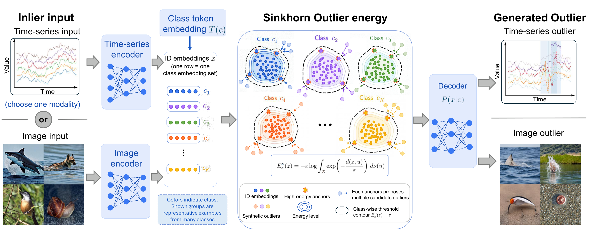

<h1 align="center">SBOG: Sinkhorn Boundary Outlier Generation</h1>

<p align="center">
  <b>Beyond Empirical Support: Structured Outlier Generation via Sinkhorn Optimal Transport</b>
  <br>
  Haixiang Sun, Andrew L. Liu — Purdue University
</p>

<h4 align="center">NeurIPS 2026</h4>

<p align="center">
  <a href="https://arxiv.org/abs/2609.31470">📄 Paper (arXiv)</a>
</p>


<p align="center"></p>

SBOG generates *structured* outliers in the latent space of a trained encoder. Instead of sampling from sparse neighbourhoods or crossing classifier boundaries, it scores every latent point with the **Sinkhorn Outlier Energy (SOE)**, an entropic optimal-transport cost to the in-distribution (ID) reference measure, picks high-energy anchors on the class-wise energy contour, proposes candidates around them, keeps the ones that stay semantically anchored to the class token, and decodes the accepted latents back to the data space with a generative decoder. The same recipe works for time series and images; this repository contains the **image experiments** (Tables 3 and 4 of the paper): CIFAR-100 and ImageNet-100 as ID data, Stable Diffusion as the decoder, and the standard outlier-exposure benchmark for evaluation.

---

## The pipeline

Each ID dataset goes through the same five stages, once per encoder branch (*normal* / *robust*). The step-1 settings live in `slurm/<dataset>/*_s12_*.sbatch`, everything else in `slurm/<dataset>/common.sh`.

#### 1. Align the encoder
Train the ResNet-34 ID encoder so that its features align with the CLIP text-token anchors of the class names (cosine logits, cross-entropy). The *robust* variant adds the multi-view Sinkhorn-DRO objective of Section 3.2. The stage ends by dumping the ID feature bank `Z_n` (500 features per class on CIFAR-100, 1,000 on ImageNet-100).<br>
`sbog/pretrain_encoder_{cifar100,in100}.py`, `sbog/pretrain_encoder_{cifar100,in100}_robust.py` &rarr; `id_feat_*.npy` of shape `(C, n, 768)`

#### 2. Sinkhorn Outlier Energy sampling
Algorithm 1 of the paper, per class: calibrate the threshold &tau;<sub>E</sub> as the 0.95-quantile of the leave-one-out SOE over `Z_n`; select the 200 highest-energy anchors among the semantically consistent pool; propose 256 Gaussian perturbations per anchor and round; accept candidates whose local and global energy exceed &tau;<sub>E</sub> while they stay within the token-cosine floor; stop at 10,000 accepted latents per class.<br>
`sbog/soe_generate_latents.py` &rarr; `outlier_energy_semantic_embed_*.npy` of shape `(C, 10000, 768)` plus a JSON with per-class statistics

#### 3. Decode the latents
Stable Diffusion v1.4 (PLMS, 50 steps) decodes the accepted latents, conditioned on the class token of the source anchor, round-robin over the classes: 25,000 iterations &times; 4 images = 100,000 outlier images.<br>
`sbog/sample_outliers_sd.py` &rarr; `generated/<branch>/samples/<class>/*.png`

#### 4. Train the detector
Outlier-exposure fine-tuning of the ID classifier with the energy score, using the decoded images as auxiliary outliers.<br>
`sbog/train_detector_{cifar100,in100}.py` &rarr; detector checkpoint `*_epoch_N.pt` (+ `_bundle.pt`)

#### 5. Evaluate
FPR95 / AUROC / AUPR on the OOD test sets; the bootstrap variant reports mean &plusmn; std over 500 resamples.<br>
`sbog/test_detector_{cifar100,in100}.py`, `sbog/test_detector_{cifar100,in100}_bootstrap.py` &rarr; log + `bootstrap_eval/<branch>_bootstrap.json`

<details>
<summary><b>Hyper-parameters</b> (click to expand)</summary>

| | CIFAR-100 | ImageNet-100 |
|:--|:--|:--|
| Encoder / classifier | ResNet-34, 768-d penultimate features (`sbog/resnet.py`, `sbog/resnet_anchor.py`) | same |
| Step 1 normal | 200 epochs, bs 256, SGD lr 0.1 (cosine), wd 5e-4, 500 features / class | 80 epochs, bs 64, lr 0.1, 1000 features / class |
| Step 1 robust | 80 epochs, bs 128, lr 0.08, 2 views, robust weight 0.10 (ramped over epochs 10&ndash;25), radius 0.03, T = 1, logit T = 0.1 | 80 epochs, bs 48, lr 0.08, 2 views, robust weight 0.20 (ramped over epochs 10&ndash;20), radius 0.03 |
| Step 2 (SOE) | &epsilon; = 0.05, &sigma; = 0.012, 200 anchors from a pool of 400 (semantic quantile 0.25), token-cosine floor 0.25 (capped at 0.90), seed-cosine floor 0.70, local reference = 128 nearest ID features, 256 proposals / anchor, &le; 4 rounds, 10,000 latents / class | identical, without the 0.90 cap |
| Step 3 (SD) | `--plms --n_iter 25000 --n_samples 4 --class_schedule round_robin` | identical, class names from `data/imagenet100/metadata` |
| Step 4 (detector) | 200 epochs, bs 256 ID + 256 outliers, lr 0.1, energy weight 2.5, trained from scratch | 30 epochs, bs 32 + 32, lr 0.001, energy weight 0.75, initialised from a CE-pretrained ResNet-34 (`setup/download_in100_ce_init.sh`) |
| Step 5 | energy score, one fifth of the ID test set drawn from each OOD set (2,000 images), 500 bootstrap trials, seed 17 | identical (2,600 images per OOD set), test batch 64 |

</details>

---

## Getting started

### 1. Environment

```bash
conda create -p ./env python=3.10 && conda activate ./env
pip install -r requirements.txt     # torch 2.6.0 + CUDA 12.4, xformers, diffusers, CLIP, ...
```
The SLURM scripts activate `./env`; set `SBOG_ENV=<name>` to use a differently named environment.

### 2. Data and weights

```bash
bash setup/download_sd_ckpt.sh              # Stable Diffusion v1.4 (sd-v1-4.ckpt, 4.3 GB; needs a Hugging Face token)
bash setup/download_cifar100_benchmark.sh   # CIFAR-100 + SVHN, Places365-test, LSUN, iSUN, Textures        (~25 GB)
bash setup/download_imagenet100.sh          # ImageNet-100 (HF ilee0022/ImageNet100) + iNaturalist/SUN/Places (~35 GB)
bash setup/download_in100_ce_init.sh        # CE-pretrained ResNet-34 used to initialise step 4 on ImageNet-100
```

Everything lands under `./data` and `./models`; the layout the scripts expect is documented at the top of each script.
Dataset roots can be overridden with `SBOG_DATA_ROOT` or the per-dataset `SBOG_*_ROOT` variables (see `sbog/dataset_paths.py`).
`tools/preflight_cifar100.sh` and `tools/preflight_in100.sh` check that everything is in place; every SLURM job runs them first.

ImageNet-100 is the 100-class subset of [Kaggle `ambityga/imagenet100`](https://www.kaggle.com/datasets/ambityga/imagenet100) (mirrored on Hugging Face as `ilee0022/ImageNet100`: 117,000 train / 13,000 val / 5,000 test images); the ImageNet OOD test sets are the de-duplicated iNaturalist / SUN / Places subsets of Huang &amp; Li (MOS), 10,000 images each.

### 3. Run

The experiments are organised as SLURM jobs (one A100-40GB each). Edit the `#SBATCH -A` / `-p` lines for your cluster, then:

```bash
sbatch slurm/cifar100/c100_smoke.sbatch        # optional: end-to-end check with tiny settings, ~10 min
bash   slurm/cifar100/submit_cifar100.sh       # both branches: step 1+2 -> step 3 -> step 4+5, chained with afterok
bash   slurm/imagenet100/submit_in100.sh
```

Each `submit_*.sh` prints the job ids. Results appear in `outputs/<dataset>/bootstrap_eval/<branch>_bootstrap.json`; `tools/collect_cifar100_table.py` / `tools/collect_in100_table.py` format them as a table row.

Approximate cost on one A100-40GB, per branch:

| | step 1 | step 2 | step 3 (SD) | step 4 | step 5 |
|:--|:--:|:--:|:--:|:--:|:--:|
| CIFAR-100 | 0.5 h | 1 min | 30 h | 4 h | 0.3 h |
| ImageNet-100 | 23 h (normal) / 43 h (robust) | 1 min | 31 h | 17 h | 0.5 h |

Without SLURM, the `run_step*` functions in `slurm/<dataset>/common.sh` are plain shell functions and can be called from any bash session after `source slurm/<dataset>/common.sh` (set `SBOG_REPO` to the repo root).

---

## Repository layout

```
sbog/        the method: step 1-5 scripts for cifar100 / in100, SOE utilities (outlier_energy_utils.py),
             Sinkhorn-DRO utilities (robust_alignment_utils.py), backbones, dataset path resolution
slurm/       SLURM pipelines (common.sh = all step 2-5 hyper-parameters), smoke tests, submit scripts
setup/       data and weight download scripts, ImageNet-100 ImageFolder / metadata / token-embedding generation
tools/       preflight checks, table formatting
assets/      token_embed_c100.npy (CLIP text anchors of the 100 CIFAR classes), imagenet_classnames.txt
ldm/ configs/  Stable Diffusion inference code (CompVis) + v1-inference.yaml
utils/       OOD metrics and loaders
docs/        pipeline figure, reproduction log
env/ data/ models/ cache/ outputs/   created by the scripts, git-ignored
```

## Citation

```bibtex
@article{sun2026beyond,
  title={Beyond Empirical Support: Structured Outlier Generation via Sinkhorn Optimal Transport},
  author={Sun, Haixiang and Liu, Andrew L},
  journal={arXiv preprint arXiv:2609.31470},
  year={2026}
}
}
```

## Acknowledgements

`ldm/` is the Stable Diffusion inference code of [CompVis](https://github.com/CompVis/stable-diffusion); the evaluation helpers in `utils/` follow the Outlier Exposure benchmark code; the CE-pretrained ImageNet-100 ResNet-34 used to initialise step 4 is the checkpoint released with [DreamOOD](https://github.com/deeplearning-wisc/dream-ood). 